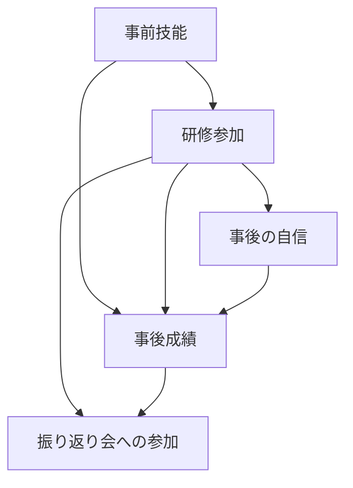

# 交絡・因果図・調整の落とし穴

Status: COMPLETE v0.1
Created: 2026-10-31

## 学習目標

因果図の矢印を仮定として読み、交絡因子・媒介変数・コライダーを区別できる。変数を多く調整するだけでは、因果効果の推定が改善しない理由を説明できる。

## 本文

1. 研修を受けた人ほど、後の業務成績が高かったとしま
2. す。
3. 研修前の技能が高い人ほど参加しやすいなら、
4. その違いも結果に混ざります。
5. 交絡は、知りたい介入と結果の関係に、
6. 共通の原因などを通る別の経路が重なる問題です。
7. 以下は仕組みを学ぶための架空の仮定です。
8. 因果図は、変数を点、直接の因果的な影響の方向を矢
9. 印で表した図です。
10. ここで使う有向非巡回グラフは、
11. 矢印をたどって出発点へ戻る輪を持ちません。
12. 図は相関表から自動的に確定する事実ではなく、
13. 時間順や現場の知識に基づく仮定を
14. 明示するものです。
15. この例では、事前技能が研修参加と事後成績の両方へ
16. 影響すると仮定します。
17. また、研修は自信を変え、それを通して成績にも影響
18. するとします。
19. 事後の振り返り会への参加は、
20. 研修を受けたことと成績の両方に左右されると置きま
21. す。
22. 図を見なくても、三つの役割は次のように区別できま
23. す。
24. 事前技能は研修と成績へ枝分かれする共通原因、
25. 自信は研修から成績へつながる途中の変数、
26. 振り返り会への参加は研修と成績の矢印がぶつかる共
27. 通の結果です。
28. 事前技能は、この仮定では交絡因子です。
29. 技能が同じ範囲の人同士を比較するなど、
30. 調整によって研修以外の経路を遮ることを考えます。
31. ただし、意欲などの未測定の共通原因があれば、
32. 技能だけでは十分でないかもしれません。
33. 事後の自信は媒介変数です。
34. 研修の総効果、つまり自信を通る分も含めた変化を知
35. りたいのに、自信を固定して比較すると、
36. その経路を取り除いてしまいます。
37. 直接の効果を問うなら別の推定対象になりますが、
38. 自信を回帰に足すだけで妥当な直接効果が得られると
39. は限りません。
40. 振り返り会への参加のように、
41. 経路上で二つの矢印が入る変数をコライダーと呼びま
42. す。
43. 参加者だけに絞ると、研修と成績を共通の結果で条件
44. 付けるため、もともと閉じていた経路が開き、
45. 比較が歪むことがあります。
46. 介入後に得た情報を何でも調整するのは危険です。
47. 調整では、介入と結果の共通原因を通る経路を遮り、
48. 必要な因果の経路を残し、コライダーの経路を開かな
49. いことを考えます。
50. 効果を観測データと仮定から一意に定められることを
51. 識別と呼び、
52. 回帰の当てはまりのよさとは区別します。
53. 実務では、介入の内容が同じ意味で定義され、
54. 調整する各範囲で比較する両群が存在するかも確認し
55. ます。
56. 図に書かなかった原因がないか、
57. 測定や対象選択に問題がないかを検討し、
58. どの仮定の下で何の効果を問うかを説明します。
59. 調整項目の数を増やすこと自体を、
60. 正しさの証拠にしないようにします。

## 注意

数字・対象は学習のために設定した架空例です。本文の比較条件を実務へそのまま適用せず、対象、前提条件、欠損、測定方法を確認してください。

## 補助図の定義（読み上げ本文の外）

## 出典

- [Pearl：Causal inference in statistics: An overview](https://ftp.cs.ucla.edu/pub/stat_ser/r350.pdf)
